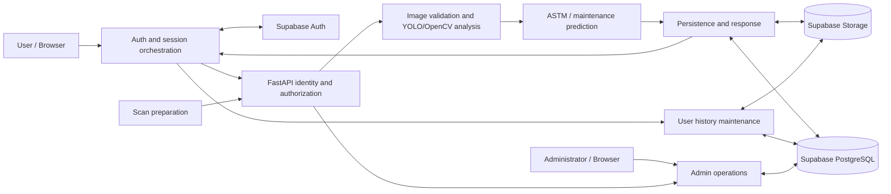

# MetalErosion Current-State DFD Context

This document is a source-grounded brief for an AI agent creating a Data Flow Diagram (DFD) for the current MetalErosion/RustScan implementation. Treat source code as authoritative. Do not turn planned architecture, TODOs, or deployment assumptions into implemented flows.

## 1. System purpose

MetalErosion is a React/Vite web application that accepts an authenticated user's image of a metal surface, estimates corrosion using a YOLO/OpenCV pipeline, classifies the result with an ISO/ASTM-oriented predictive engine, stores the scan, and displays the result and scan history. An admin can inspect account, scan-metric, and recovery-log data.

## 2. System boundary and deployment

```text
User Browser
  └─ React/Vite frontend (local development or deployed static frontend)
       ├─ Supabase Auth browser client
       └─ FastAPI backend (default local URL: http://localhost:8000)
             ├─ YOLO model file + OpenCV processing
             ├─ ISO/ASTM predictive engine
             └─ Supabase database and Storage
```

The frontend's API base URL is `VITE_API_BASE_URL`, defaulting to `http://localhost:8000`. The browser Supabase client uses `VITE_SUPABASE_URL` and `VITE_SUPABASE_ANON_KEY`. The backend uses server-side Supabase credentials and a Storage bucket configured by `SUPABASE_STORAGE_BUCKET` (default `metal-scans`).

## 3. External entities

| Entity | Role in the current system |
| --- | --- |
| **User / Browser** | Enters credentials, chooses a scan image and title, views results/history, and may delete or rename owned scans. |
| **Administrator / Browser** | Uses the same frontend with an admin account to request account lists, metrics, recovery requests, and account/recovery updates. |
| **Supabase Auth** | Creates users, sends confirmation/recovery email flows, maintains sessions, and issues access tokens. |
| **Supabase PostgreSQL** | Stores application profiles, scan metadata, and password-reset log records. |
| **Supabase Storage** | Stores uploaded scan image objects and returns signed URLs. |

Email delivery is an Auth-managed external side effect. The repository does not contain an email service of its own.

## 4. Internal processes

### P1 — Frontend authentication and session orchestration

Implemented in `frontend/src/services/supabase.ts`, `frontend/src/App.tsx`, and `frontend/src/components/AuthModal.tsx`.

- Calls Supabase Auth for signup, password login, confirmation resend, forgot-password email, password update, session restore, auth-state changes, and sign-out.
- Keeps the current account, access token-backed session, current view, history, and admin state in React memory.
- Calls `GET /me` after a session is available to obtain the backend profile and authoritative role when possible.
- The frontend hides admin navigation for ordinary users, but this is not the security boundary.

### P2 — Scan preparation and request

Implemented in the home/upload and calculating pages plus `frontend/src/services/api.ts`.

- The user selects an image and a scan title.
- The frontend creates a browser preview URL and sends a multipart request to `POST /analyze-corrosion`.
- The request includes `file`, optional `title`, and an `Authorization: Bearer <Supabase access token>` header.
- The frontend does not call `/analyze-asset`; that is a backend alias.

### P3 — Backend identity and authorization

Implemented in `backend/main.py`.

- Reads the bearer token from the `Authorization` header.
- Calls `supabase.auth.get_user(token)`.
- Derives the authenticated user ID from the verified token.
- Returns `401` for missing/invalid/expired tokens.
- For admin routes, reads `profiles.role` and returns `403` unless it is `admin`.
- A submitted form `user_id` is only a compatibility value and must match the verified ID; it is not trusted as the identity source.

### P4 — Corrosion image analysis

Implemented in `backend/main.py`.

- Validates that the upload has an image content type, is non-empty, and is no larger than 15 MB.
- Decodes bytes with OpenCV.
- Runs the loaded YOLO model to detect candidate corrosion regions.
- Expands detection boxes by the configured padding, creates HSV rust masks, and calculates rust percentage from masked pixels over total image pixels.
- Produces flattened detection box coordinates.

### P5 — ASTM/maintenance prediction

Implemented in `backend/predictive_engine.py` and called by the analysis and history paths.

- Uses rust percentage and an asset category (default `Hardware`).
- Maps rust percentage to an ASTM grade and remediation protocol.
- Uses a category regression slope to calculate days to critical condition and a priority tier.
- The scan response exposes the grade, priority label, and recommendation. The internal days-to-critical and slope are not included in the normal scan response.

### P6 — Scan persistence and response

Implemented in `backend/main.py`.

- Uploads the original image bytes to Storage at `scans/{verified_user_id}/{generated_uuid}.jpg|png`.
- Creates a signed URL for the uploaded object.
- Inserts scan metadata into `scans`.
- Returns a normalized analysis response to the frontend.
- If database persistence fails after upload, attempts to remove the uploaded Storage object.

### P7 — User history maintenance

Implemented in `frontend/src/services/api.ts` and `backend/main.py`.

- `GET /history` reads scans belonging to the verified user, newest first, and regenerates a signed image URL when `storage_path` is available.
- `PATCH /history/{scan_id}` updates only the title of a scan owned by the verified user.
- `DELETE /history/{scan_id}` removes the owned Storage object when `storage_path` exists and then deletes the database row.
- History records recalculate ASTM/maintenance fields from their stored rust percentage when returned.

### P8 — Admin data operations

Implemented in `frontend/src/pages/AdminPage.tsx`, `frontend/src/services/api.ts`, and `backend/main.py`.

- Admin UI loads accounts, scan metrics, and password-reset logs in parallel.
- `GET /admin/accounts` reads profile records.
- `PATCH /admin/accounts/{account_id}` updates profile username, email, and/or role.
- `GET /admin/metrics?range=day|week|month` counts profiles and scans using `scans.created_at`.
- `GET /admin/recovery-requests` reads `password_reset_logs` joined with profile identity fields.
- `PATCH /admin/recovery-requests/{request_id}` updates a recovery-log status.
- `PATCH /admin/accounts/{account_id}/status` exists but intentionally returns `409`; the confirmed profile schema has no status persistence. Do not draw it as a successful data flow.

## 5. Data stores

| Store | Current contents and important fields |
| --- | --- |
| **D1 — Supabase Auth (`auth.users`)** | Auth identities, email/password credentials managed by Supabase, confirmation/recovery state, sessions, access tokens. |
| **D2 — `profiles` table** | `id`, `role`, `email`, `username`, `created_at`. The backend uses this store for account display and admin authorization. |
| **D3 — `scans` table** | `id`, `user_id`, `image_url`, `storage_path`, `title`, `rust_percentage`, `box_coordinates`, `created_at`. `user_id` is linked to the verified Supabase identity. |
| **D4 — Supabase Storage bucket** | Uploaded source/cropped scan image bytes under a user-scoped generated path. The backend stores a signed URL in `image_url` and can generate a fresh one from `storage_path`. |
| **D5 — `password_reset_logs` table** | `id`, `user_id`, `status`, `requested_at`; profile username/email are read through the relationship. The application reads and updates these records; the repository does not show the writer. |
| **D6 — Browser React state** | Current account, session-derived access, selected/uploaded image, current result, in-memory history, admin lists/metrics, loading/error state. This is transient and not a durable data store. |

## 6. Primary data flows

### Authentication and account flows

1. **Credentials → P1:** email, username (signup), and password.
2. **P1 → D1/Supabase Auth:** signup, password login, confirmation resend, forgot-password request, password update, and sign-out commands.
3. **D1 → P1:** Auth user, session, access token, and auth errors/events.
4. **P1 → P3:** `Authorization: Bearer <access token>` on protected API calls.
5. **P3 → D1:** token verification through `supabase.auth.get_user`.
6. **P3 ↔ D2:** profile lookup for `/me` and admin-role authorization.
7. **P3 → P1:** authenticated account/profile response or `401`/`403` error.

### Corrosion analysis flow

1. **User → P2:** image file and scan title.
2. **P2 → P3:** multipart upload plus bearer token.
3. **P3 → P4:** validated image bytes and verified user context.
4. **P4 → P5:** calculated `rust_percentage`, detection boxes, and asset category.
5. **P5 → P6:** ASTM grade, priority tier, and remediation recommendation.
6. **P6 → D4:** image bytes at the generated user-scoped Storage path.
7. **D4 → P6:** signed image URL.
8. **P6 → D3:** user ID, image URL/path, title, rust percentage, box coordinates, and database timestamp.
9. **P6 → P2:** JSON result containing filename/title, image URL, rust percentage, ASTM grade, priority, recommendation, box coordinates, scan ID, creation time, and user ID.
10. **P2 → D6/UI:** mapped `ScanResult` shown on the results page and added to in-memory history.

### History flows

1. **P1/P2 → P7:** access token and `GET /history`.
2. **P7 ↔ D3:** select only the verified user's scans, ordered by `created_at` descending.
3. **P7 ↔ D4:** generate a fresh signed URL from `storage_path` when present.
4. **P7 → P5:** stored rust percentage and default `Hardware` category for derived display fields.
5. **P7 → P1/D6:** history scan records mapped to `ScanResult`.
6. **User → P7:** scan title edit or delete request with a scan ID.
7. **P7 ↔ D3/D4:** update owned title, or delete the owned Storage object and scan row.

### Admin flows

1. **Administrator → P8:** admin page load, metric-range selection, account edits, and recovery-status actions.
2. **P8 → P3:** bearer token and requested admin operation.
3. **P3 ↔ D2:** verify `profiles.role = admin`; read/update profile data.
4. **P3 ↔ D3:** count scans for day/week/month metrics.
5. **P3 ↔ D5:** read recovery requests and update their status.
6. **P8 → D6/UI:** account records, metrics, recovery requests, and API errors.

## 7. Implemented HTTP endpoint inventory

| Method and path | Caller | Current effect |
| --- | --- | --- |
| `POST /analyze-corrosion` | Authenticated user | Analyze image, upload to Storage, insert `scans` row, return result. |
| `POST /analyze-asset` | Authenticated user | Backend alias of the same analysis handler; not called by the current frontend. |
| `GET /me` | Authenticated user | Return profile-backed account information. |
| `GET /history` | Authenticated user | Return owned scans with derived classification fields. |
| `PATCH /history/{scan_id}` | Authenticated user | Rename an owned scan. |
| `DELETE /history/{scan_id}` | Authenticated user | Delete an owned scan and its stored object when possible. |
| `POST /predict-maintenance` | Authenticated user | Return prediction output for submitted rust percentage/category; does not persist a scan. |
| `GET /admin/accounts` | Admin | List profiles. |
| `PATCH /admin/accounts/{account_id}` | Admin | Update profile username, email, or role. |
| `PATCH /admin/accounts/{account_id}/status` | Admin | Always returns `409` because status is not persisted in the confirmed schema. |
| `GET /admin/metrics?range=...` | Admin | Count profiles and scans for the selected periods. |
| `GET /admin/recovery-requests` | Admin | List password-reset log records with profile identity fields. |
| `PATCH /admin/recovery-requests/{request_id}` | Admin | Update a password-reset log status. |

## 8. Important response mappings

### Analysis/history response → frontend `ScanResult`

| Backend field | Frontend field |
| --- | --- |
| `scan_id` | `id` |
| `filename` | `imageName` |
| `title` | `title` |
| `image_url` | `imageUrl` |
| `rust_percentage` | `rustPercent` |
| `astm_grade` | `astmGrade`, and `classification = "ASTM Grade <grade>"` |
| `priority_level` | `priorityLevel`, `classificationLabel` |
| `recommendation` | `dss` |
| `created_at` | `createdAt`, formatted `date` |
| `user_id` | `accountId` |

### Admin responses → frontend state

- `/me` and `/admin/accounts` provide account identity, username, email, role, and timestamps.
- `/admin/metrics` provides total/active account counts and day/week/month scan counts.
- `/admin/recovery-requests` provides request ID, related user ID, profile username/email, status, and request time.

## 9. Trust boundaries and security-relevant DFD annotations

- The browser is an untrusted client. UI route visibility and client-side `role` values are not authorization.
- The bearer token crosses the browser/backend boundary and is verified by Supabase through the backend.
- The backend derives scan ownership from the verified token, not from arbitrary form data.
- Admin routes have a second authorization check against `profiles.role`.
- Supabase service credentials remain server-side; the browser receives only the publishable Supabase key and session token.
- Scan image objects are user-scoped by generated Storage path. Signed URLs are returned for image access.
- API errors include authentication (`401`), authorization (`403`), validation (`400`), missing records (`404`), conflict for unsupported status changes (`409`), Storage/persistence failures (`502`), and model failures (`503`).

## 10. Current-state caveats for the diagramming agent

Do not draw these as completed flows:

- Future endpoints or behavior described only as recommendations in handoff files.
- Successful account deactivation/status persistence; the endpoint currently rejects it.
- A frontend call to `/analyze-asset`; only the backend alias exists.
- A local database, ORM, migration system, or application-owned email service.
- A password-reset-log writer inside this repository; only read/update operations are shown.
- Internal model training as a user-request data flow. `ISOPredictiveEngine` creates regression models at backend startup, but the DFD should show prediction at request time and may annotate startup initialization separately.
- `days_to_critical` and `active_regression_slope` in the normal frontend result; they are internal prediction values and are not returned by the scan handler.

The hosted Supabase schema, RLS policies, bucket privacy, and deployment URLs are external configuration. Show Supabase as an external managed subsystem and label schema/policy details as configuration unless verified outside this repository.

## 11. Suggested DFD views

### Context-level diagram

Use one system process, **MetalErosion/RustScan**, with:

- User and Administrator as external actors.
- Supabase Auth, Supabase Database, and Supabase Storage as external managed systems.
- Input: credentials, image, scan title, history/admin commands.
- Output: auth/session state, analysis result, history, admin data, signed image URL, and errors.

### Level-1 diagram

Decompose the system into P1–P8 above. Use D1–D6 as data stores and label each arrow with the concrete payload or operation from Sections 6–8. Keep the browser React state store separate from durable Supabase stores.

### Mermaid starting point



This Mermaid is only a starting topology. Add labeled flows from the tables above and do not add unverified future components.

## 12. Source references

- `backend/main.py` — FastAPI routes, bearer-token verification, image analysis, Storage/database persistence, history, and admin operations.
- `backend/predictive_engine.py` — ASTM classification and maintenance prediction.
- `frontend/src/App.tsx` — session restoration, auth events, route/view orchestration, and state updates.
- `frontend/src/services/supabase.ts` — browser Supabase client.
- `frontend/src/services/api.ts` — HTTP calls and response-to-frontend mappings.
- `frontend/src/types/index.ts` — frontend data contracts.
- `frontend/src/pages/CalculatingPage.tsx` — authenticated analysis request lifecycle.
- `frontend/src/pages/AdminPage.tsx` — admin data presentation and mutation actions.
- `PROJECT_ARCHITECTURE_HANDOFF.md` and `BACKEND_AGENT_HANDOFF.md` — useful context, but recommendations and unverified external setup are not proof of current implementation.
