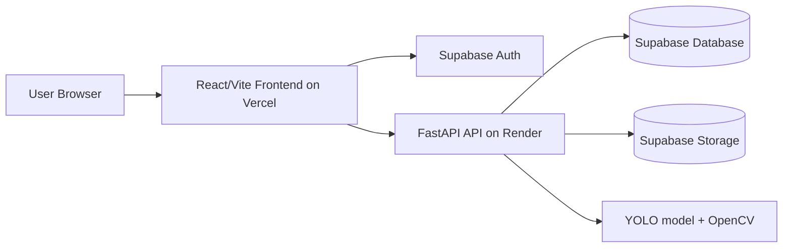
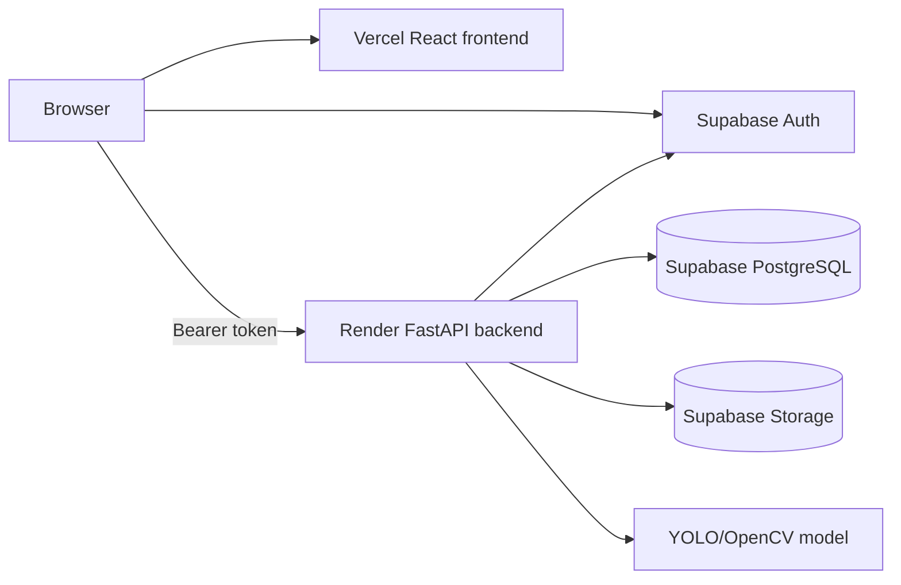

# MetalErosion System Architecture Handoff

## Purpose

This document is for engineers continuing work on the MetalErosion compliance/defense project. It describes the current system boundaries, ownership rules, data flows, deployment plan, known limitations, and safe next steps.

The project is intended for controlled academic defense and demonstration use. Keep the architecture understandable, auditable, and small. Do not add production-scale infrastructure unless it is required by a demonstrated need.

## System Summary

MetalErosion is a React/Vite frontend for uploading metal-surface images and displaying corrosion analysis. The analysis is performed by a FastAPI backend using YOLO/OpenCV and an ISO/ASTM predictive engine. Supabase provides authentication, database persistence, and object storage.

Recommended deployment topology:



## Repository Layout

```text
MetalErosion/
  frontend/                 React/Vite application
    src/App.tsx             Session, routing, page orchestration
    src/components/         Shared UI, including AuthModal
    src/pages/              User, history, results, and admin screens
    src/services/api.ts     FastAPI request/response adapter
    src/services/supabase.ts Browser Supabase Auth client
    src/types/index.ts      Shared frontend contracts
  backend/
    main.py                 FastAPI routes, auth verification, analysis persistence
    predictive_engine.py    ISO/ASTM maintenance prediction logic
    models/best.pt          YOLO model used for image detection
  vercel.json               SPA fallback for direct frontend routes
  VERCEL_URL_GUIDE.md       Deployment URL and environment checklist
  SUPABASE_DATABASE_STORAGE_ISSUES.md
                            External schema and storage migration notes
```

## Responsibility Boundaries

### Browser frontend

The frontend is responsible for:

- Rendering the application and auth screens.
- Calling Supabase Auth with the publishable browser key.
- Restoring the current Supabase session.
- Sending the Supabase access token to FastAPI.
- Displaying analysis, history, and admin data returned by the backend.
- Handling empty, loading, expired-session, and user-facing error states.

The frontend is not a security boundary. Do not trust frontend role, user ID, account status, or route visibility for authorization.

### Supabase Auth

Supabase Auth is the authority for:

- Email/password signup.
- Email confirmation links.
- Login sessions and access tokens.
- Forgot-password email links.
- Recovery sessions and password updates.

The application no longer uses a six-digit recovery PIN. The Supabase profile trigger/schema must be updated separately so `recovery_pin` is not required.

### FastAPI backend

The backend is responsible for:

- Verifying the bearer token with Supabase.
- Deriving the authenticated user ID server-side.
- Enforcing admin access using `profiles.role`.
- Validating uploaded images.
- Running YOLO/OpenCV corrosion analysis.
- Running the ISO/ASTM predictive engine.
- Uploading source images to Supabase Storage.
- Persisting scan records and serving user-scoped history.
- Returning stable response contracts to the frontend.

### Supabase Database and Storage

Supabase stores:

- Auth users in `auth.users`.
- Application profiles in `public.profiles`.
- Scan metadata in `public.scans`.
- Optional recovery/audit records in `public.password_reset_logs`.
- Source images in the configured Storage bucket, currently expected to be `metal-scans`.

## Authentication Flows

### Signup and email confirmation

1. The user submits email, username, and password in `AuthModal`.
2. The frontend calls `supabase.auth.signUp` with username metadata.
3. Supabase creates the Auth user and sends a confirmation email when confirmation is enabled.
4. The profile trigger creates the matching profile row.
5. The user follows the email link and returns to the configured frontend URL.
6. The user logs in after confirmation.

The frontend should not assume that signup returns an active session. A missing session may mean confirmation is required.

### Login

1. The frontend calls `supabase.auth.signInWithPassword`.
2. Supabase returns a session and access token.
3. The frontend calls `GET /me` with the bearer token.
4. The backend returns the application profile and authoritative role.
5. The frontend routes admins to the admin page and normal users to the home page.

### Password recovery

1. The user chooses Forgot Password.
2. The frontend calls `resetPasswordForEmail` with the stable `/reset-password` redirect path.
3. Supabase sends a recovery email.
4. The user follows the link.
5. Supabase creates a recovery session and emits `PASSWORD_RECOVERY`.
6. The frontend displays the new-password form.
7. The frontend calls `updateUser({ password })`.
8. The user is signed out and can log in with the new password.

The admin does not manually reset ordinary user passwords. Admin functionality is for account support, roles, status, and investigation.

## API Contracts

All protected API requests use:

```http
Authorization: Bearer <supabase-access-token>
```

### Current account

```http
GET /me
```

Returns the authenticated profile, including the user ID, email, username, role, status, and timestamps when available.

### Corrosion analysis

```http
POST /analyze-corrosion
POST /analyze-asset
```

Multipart fields:

```text
file: image upload
asset_category: optional category
```

The authenticated user is derived from the bearer token. A browser-submitted user ID must never determine ownership.

Response shape:

```json
{
  "status": "success",
  "filename": "image.jpg",
  "image_url": "https://...",
  "rust_percentage": 12.34,
  "astm_grade": 6,
  "priority_level": "Moderate",
  "recommendation": "...",
  "box_coordinates": [],
  "scan_id": "uuid",
  "created_at": "timestamp",
  "user_id": "uuid"
}
```

### User history

```http
GET /history
DELETE /history/{scan_id}
```

History is scoped to the authenticated user. Deleting a scan should delete both the database record and its Storage object when `storage_path` is available.

### Admin endpoints

```http
GET   /admin/accounts
PATCH /admin/accounts/{account_id}
GET   /admin/metrics?range=day|week|month
GET   /admin/recovery-requests
PATCH /admin/recovery-requests/{request_id}
```

Every admin route must verify `profiles.role` on the backend. The frontend admin page is only a convenience view.

Account deactivation is not fully supported until the profile schema has a real status column. The current status mutation endpoint intentionally refuses unsupported persistence rather than pretending it works.

## Data and Security Rules

- Use `profiles.role` as the authoritative role source.
- Derive user identity from the verified Supabase token.
- Never expose a Supabase service-role key to Vercel or browser code.
- Use `VITE_SUPABASE_ANON_KEY` only in the frontend.
- Use `SUPABASE_SERVICE_ROLE_KEY` or the server-side compatibility variable only on Render.
- Keep Storage object paths scoped by authenticated user ID.
- Keep private Storage buckets private and issue signed URLs when required.
- Store a permanent `storage_path` in `scans`; signed URLs can expire.
- Do not log access tokens, passwords, service keys, or recovery links.
- Do not treat an account as deactivated merely because it has not recently logged in.
- Email verification and password reset are separate from business account status.

## Environment Contracts

### Frontend: Vercel or local `.env`

```env
VITE_API_BASE_URL=https://<render-service>.onrender.com
VITE_SUPABASE_URL=https://<project-ref>.supabase.co
VITE_SUPABASE_ANON_KEY=<supabase-publishable-anon-key>
```

### Backend: Render

```env
SUPABASE_URL=https://<project-ref>.supabase.co
SUPABASE_SERVICE_ROLE_KEY=<server-only-key>
SUPABASE_STORAGE_BUCKET=metal-scans
SUPABASE_STORAGE_PRIVATE=true
SUPABASE_SIGNED_URL_TTL=3600
FRONTEND_ORIGINS=https://<vercel-project>.vercel.app
MODEL_PATH=models/best.pt
```

See [VERCEL_URL_GUIDE.md](VERCEL_URL_GUIDE.md) for the deployment checklist and Supabase redirect URL configuration.

## External Supabase Work Required

The repository cannot change the hosted Supabase project automatically. Before testing signup:

1. Update the profile creation trigger so it no longer reads or requires `recovery_pin`.
2. Confirm `profiles.username` is populated from signup metadata.
3. Test a new signup with email confirmation enabled.
4. Test forgot-password recovery.
5. Only after the trigger is updated and tested, remove the old column:

```sql
alter table public.profiles
  drop column if exists recovery_pin;
```

Also confirm:

- `profiles.id` references `auth.users.id`.
- `profiles.role` has a safe default and constraint.
- `scans.storage_path` exists.
- The `metal-scans` bucket exists.
- Storage policies match the selected public/private model.
- RLS policies do not allow normal users to read other users' scans.
- Email confirmation and password recovery redirect URLs include the deployed frontend URL.

## Deployment Architecture

### Vercel

Deploy the `frontend` directory as a Vite project:

```text
Build command: npm run build
Output directory: dist
```

Vercel serves the SPA. `vercel.json` rewrites direct paths such as `/reset-password` to `index.html`.

### Render

Deploy the `backend` directory as a Python web service. A typical start command is:

```text
uvicorn main:app --host 0.0.0.0 --port $PORT
```

Validate Render suitability for the YOLO model, OpenCV dependencies, memory, cold start, request duration, and uploaded-image size before the defense.

## Architecture Work Queue

### Priority 1: Required before end-to-end testing

- Update the Supabase profile trigger and remove the recovery PIN requirement.
- Configure Supabase Auth email confirmation and redirect URLs.
- Add real Vercel and Render URLs to environment variables and CORS.
- Confirm `scans.storage_path` and the `metal-scans` bucket.
- Run signup, email confirmation, login, password reset, upload, history, and logout smoke tests.

### Priority 2: Recommended standardization

- Add a real `profiles.status` column if account deactivation is needed.
- Add a real `last_sign_in_at` or `last_active_at` policy with a precise meaning.
- Decide whether `password_reset_logs` is an audit log or remove the unused admin recovery panel.
- Add tests for expired tokens, unauthorized admin requests, invalid images, and Storage failures.
- Add a backend health endpoint for Render smoke checks.

### Priority 3: Optional defense improvements

- Add an audit log for role changes and account status changes.
- Add scan retention or manual image cleanup to control Storage usage.
- Add a compact admin activity view without claiming real-time online presence.
- Add custom SMTP only if email delivery is unreliable during demonstrations.

## Safe Change Rules for Future Agents

Before editing:

1. Identify whether the change belongs in Supabase Auth, the frontend, FastAPI, or the external Supabase schema.
2. Preserve the token/role ownership boundary.
3. Read the relevant response contract before changing UI or API code.
4. Avoid adding mock accounts, mock scans, random analysis results, or client-side authorization.
5. Keep deployment URLs as placeholders in tracked documentation until the real values exist.

After editing:

1. Run `npm run build` from `frontend`.
2. Run `python -m py_compile backend/main.py`.
3. Run diagnostics for changed TypeScript files.
4. Test direct navigation to `/reset-password`.
5. Check that no secret values are tracked or printed.

## Current Known Limitations

- The hosted Supabase schema is external and may still require the recovery PIN until migrated.
- Account status persistence is not available in the confirmed profile schema.
- The admin recovery request table has no clearly documented writer in the current application flow.
- The exact production Vercel and Render URLs are placeholders.
- The YOLO/Render production resource profile has not yet been validated.
- The frontend build and local runtime require valid `VITE_SUPABASE_URL` and `VITE_SUPABASE_ANON_KEY` values.
# MetalErosion Project Architecture Handoff

This document is the working architecture brief for another engineer or coding agent. Read it before changing authentication, Supabase, image storage, FastAPI routes, or deployment configuration.

## 1. Project Purpose

MetalErosion, presented in the UI as RustScan, analyzes images of metal surfaces and estimates corrosion severity. The system returns:

- Rust percentage
- ASTM grade
- Maintenance priority
- Maintenance recommendation
- Detection box coordinates
- A persisted scan history record

This is a small academic compliance and defense project. The intended deployment is:

- React/Vite frontend on Vercel
- FastAPI and YOLO/OpenCV inference backend on Render
- Supabase Auth, PostgreSQL tables, and Storage

Do not introduce production-scale infrastructure unless a project owner explicitly requests it.

## 2. Repository Structure

```text
MetalErosion/
├── frontend/
│   ├── src/App.tsx                 Application state and view orchestration
│   ├── src/components/AuthModal.tsx Login, signup, verification, recovery UI
│   ├── src/services/supabase.ts    Browser Supabase Auth client
│   ├── src/services/api.ts         FastAPI request and response adapters
│   ├── src/types/index.ts          Shared frontend contracts
│   ├── src/pages/                  User, history, result, and admin views
│   ├── .env.example                Frontend environment template
│   └── package.json                Vite scripts and dependencies
├── backend/
│   ├── main.py                     FastAPI routes, auth, analysis, storage
│   ├── predictive_engine.py        ASTM/maintenance prediction logic
│   ├── models/best.pt              YOLO model
│   ├── requirements.txt            Python dependencies
│   └── .env.example                Render/backend environment template
├── vercel.json                     SPA fallback for direct frontend routes
├── VERCEL_URL_GUIDE.md             URL, redirect, and deployment checklist
└── SUPABASE_DATABASE_STORAGE_ISSUES.md
                                    External schema and Storage prerequisites
```

## 3. System Boundaries

### Frontend: Vercel

The frontend is responsible for:

- Rendering pages and forms
- Calling Supabase Auth from the browser
- Holding the current session in the Supabase client
- Sending the Supabase access token to FastAPI
- Displaying backend analysis and history responses
- Providing admin UI controls

The frontend is not a security boundary. Do not trust browser-provided roles, user IDs, or account status for authorization.

### Backend: Render

FastAPI is responsible for:

- Verifying Supabase bearer tokens
- Deriving the authenticated user ID server-side
- Enforcing admin authorization through `profiles.role`
- Validating image uploads
- Running YOLO/OpenCV analysis
- Running the predictive maintenance engine
- Uploading source images to Supabase Storage
- Persisting scan records
- Serving protected history and admin endpoints

### Supabase

Supabase is responsible for:

- Email/password Auth
- Email confirmation
- Password reset links
- Session and token handling
- PostgreSQL persistence
- Storage object persistence

Normal password recovery should be handled by Supabase Auth. Admins should support exceptional cases, account status, and role administration, not manually handle ordinary password resets.

## 4. Authentication Architecture

The application uses Supabase Auth directly in the frontend.

### Signup

1. User submits email, username, and password.
2. Frontend calls `supabase.auth.signUp()`.
3. Username is sent as user metadata.
4. Supabase sends a confirmation email when Confirm email is enabled.
5. User follows the confirmation link.
6. User returns to the frontend and logs in.

The old six-digit recovery PIN has been removed from runtime frontend code. The Supabase profile trigger and schema must also stop requiring `profiles.recovery_pin` before new signup can work.

### Login

1. Frontend calls `signInWithPassword()`.
2. Supabase returns a session and access token.
3. Frontend calls protected `GET /me`.
4. Backend returns the authoritative profile and role.
5. Frontend routes admins to the admin view and users to the home view.

Do not use `user_metadata.role` or browser state as the authoritative admin check.

### Password recovery

1. User opens Login and selects Forgot Password.
2. Frontend calls `resetPasswordForEmail()`.
3. Redirect target is `<frontend-origin>/reset-password`.
4. Supabase creates a recovery session when the link is opened.
5. `PASSWORD_RECOVERY` switches the frontend to the reset-password view.
6. User submits a new password.
7. Frontend calls `updateUser({ password })`.
8. Frontend signs out and asks the user to log in again.

The reset URL must be present in Supabase Authentication > URL Configuration and must be served by the Vite SPA fallback.

## 5. Auth and Environment Contracts

### Frontend variables

```env
VITE_API_BASE_URL=https://<render-service>.onrender.com
VITE_SUPABASE_URL=https://<project-ref>.supabase.co
VITE_SUPABASE_ANON_KEY=<publishable-supabase-key>
```

These values are bundled into the browser. Only the publishable/anon key belongs here.

### Backend variables

```env
SUPABASE_URL=https://<project-ref>.supabase.co
SUPABASE_SERVICE_ROLE_KEY=<server-only-key>
SUPABASE_STORAGE_BUCKET=metal-scans
SUPABASE_STORAGE_PRIVATE=true
SUPABASE_SIGNED_URL_TTL=3600
FRONTEND_ORIGINS=https://<vercel-project>.vercel.app
MODEL_PATH=models/best.pt
```

The backend currently accepts `SUPABASE_KEY` as a compatibility fallback, but new deployments should use `SUPABASE_SERVICE_ROLE_KEY`. Never expose this key through Vercel or frontend code.

## 6. Data Model Expectations

### `profiles`

Expected current fields:

```text
id          UUID, references auth.users(id)
email       TEXT
username    TEXT
role        TEXT: user | admin
created_at  TIMESTAMPTZ
```

The old `recovery_pin` field should be removed after the profile creation trigger no longer references it:

```sql
alter table public.profiles
 drop column if exists recovery_pin;
```

Do not run that SQL before updating the trigger.

Optional future fields:

```text
status          active | deactivated
last_active_at  TIMESTAMPTZ
```

The current backend does not have confirmed persistence for those optional fields. Do not pretend account status is implemented until the schema supports it.

### `scans`

Expected fields:

```text
id              UUID
user_id         UUID
image_url       TEXT
storage_path    TEXT
rust_percentage NUMERIC
box_coordinates INTEGER[]
created_at      TIMESTAMPTZ
```

`storage_path` should be treated as the durable reference. Signed URLs can expire and should be regenerated for history responses when the bucket is private.

### `password_reset_logs`

The admin API can read and update this table, but the standard Supabase email reset flow does not automatically create application-level recovery records. Decide explicitly whether this table is:

- An audit table populated by a trigger/Edge Function/backend workflow, or
- Unused and removed from the admin UI

Do not present it as a complete recovery workflow until records are actually created.

## 7. API Contract

### Public or authenticated user routes

```text
POST /analyze-corrosion
POST /analyze-asset
POST /predict-maintenance
GET  /history
DELETE /history/{scan_id}
GET  /me
```

All meaningful user routes require:

```http
Authorization: Bearer <supabase-access-token>
```

The backend derives `user_id` from the verified token. A browser-submitted user ID must not control ownership.

### Admin routes

```text
GET   /admin/accounts
PATCH /admin/accounts/{account_id}
GET   /admin/metrics
GET   /admin/recovery-requests
PATCH /admin/recovery-requests/{request_id}
```

Admin access is enforced server-side by checking `profiles.role == "admin"`.

Account status mutation is intentionally not a working feature until the schema has a status field.

### Analysis response

```json
{
  "status": "success",
  "filename": "image.jpg",
  "image_url": "https://...",
  "rust_percentage": 12.34,
  "astm_grade": 6,
  "priority_level": "Moderate",
  "recommendation": "...",
  "box_coordinates": [],
  "scan_id": "uuid",
  "created_at": "timestamp",
  "user_id": "uuid"
}
```

The frontend adapter in `frontend/src/services/api.ts` maps these snake_case fields to the `ScanResult` type.

## 8. Image and Storage Flow

1. Frontend selects an image.
2. Frontend sends it to FastAPI with the Supabase access token.
3. FastAPI validates content type, size, and decoded image bytes.
4. YOLO/OpenCV computes corrosion data.
5. FastAPI uploads the source image to the configured bucket under a user-scoped path:

```text
scans/{verified-user-id}/{filename}
```

6. FastAPI stores the Storage path and result data in `scans`.
7. FastAPI returns a signed or public URL according to Storage configuration.
8. History is scoped to the authenticated user.
9. Deleting history should remove both the database row and the Storage object.

Storage costs are driven mainly by retained image files, not by auth timestamps or account metadata. For this academic project, keep the existing upload size limit and delete images when their scan records are intentionally deleted.

## 9. Deployment Architecture



Vercel should host the `frontend` directory with:

```text
Build command: npm run build
Output directory: dist
```

Render should host the `backend` directory with a command similar to:

```text
uvicorn main:app --host 0.0.0.0 --port $PORT
```

Vercel is not the preferred host for the YOLO/OpenCV backend because model size, memory, cold starts, request duration, and native dependencies need validation.

See `VERCEL_URL_GUIDE.md` for placeholders and exact Supabase redirect/CORS configuration.

## 10. Security Rules for Future Agents

- Never commit `.env` files or credentials.
- Never send the service-role key to the browser.
- Never use frontend role state as backend authorization.
- Never trust a submitted `user_id` for ownership.
- Keep Storage paths scoped to the verified user ID.
- Do not log passwords, access tokens, Supabase keys, recovery links, or sensitive image data.
- Keep CORS restricted to known frontend origins.
- Validate file content before using image dimensions or model inference.
- Treat signed URLs as temporary and avoid storing them as the permanent identity of an image.
- Do not reintroduce the recovery PIN unless a deliberate custom recovery design is approved.

## 11. Known Issues and Required Decisions

### Required before signup testing

- Update the Supabase profile trigger so it does not require `recovery_pin`.
- Remove the column after the trigger migration is complete.
- Confirm email confirmation behavior in Supabase Auth settings.

### Required before deployment

- Replace all URL placeholders in `VERCEL_URL_GUIDE.md`.
- Add Vercel production and approved local/preview reset URLs to Supabase.
- Add the exact Vercel origin to Render `FRONTEND_ORIGINS`.
- Confirm the Render Storage bucket and signed URL settings.
- Confirm `scans.storage_path` exists.
- Test the YOLO backend on Render for memory and cold-start behavior.

### Known implementation gaps

- `last_active_at` is not yet a reliable activity timestamp.
- Account deactivation is not persisted because the confirmed profile schema has no status field.
- The admin recovery log workflow needs a writer or should be removed.
- No automated frontend test suite currently exists.
- Supabase dashboard settings and SQL migrations are external to this repository.

## 12. Recommended Work Order for the Next Agent

1. Inspect the actual Supabase schema and Auth trigger.
2. Remove the `recovery_pin` dependency safely.
3. Configure and test email confirmation.
4. Test password recovery through `/reset-password`.
5. Verify `/me` returns the correct profile and authoritative role.
6. Confirm RLS and Storage policies.
7. Deploy the frontend to Vercel.
8. Deploy FastAPI to Render.
9. Replace URL placeholders and configure CORS.
10. Run the complete signup, confirmation, recovery, upload, history, deletion, and admin smoke test.

## 13. Definition of Done

The architecture work is complete when:

- A new user can sign up without a recovery PIN.
- The user receives and completes email confirmation.
- An unconfirmed user cannot access protected features when confirmation is enabled.
- A user can request and complete password recovery.
- Password recovery links work on local and Vercel URLs.
- FastAPI accepts only valid Supabase bearer tokens.
- User history is isolated by verified user ID.
- Admin routes reject non-admin users server-side.
- Images persist in the configured Storage bucket and are deleted with their scan record.
- No server-only credentials are present in the frontend build.
- The Vercel frontend and Render backend communicate using configured origins.
