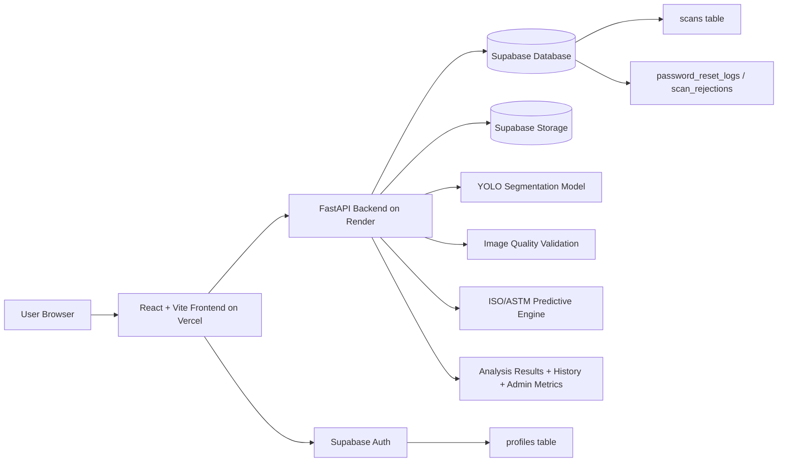
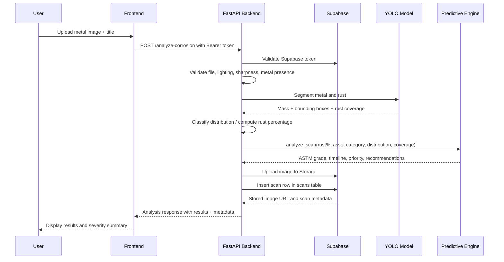

# MetalErosion System Architecture

## 1. System Overview

MetalErosion is a web-based corrosion inspection and predictive maintenance system for metal surfaces. It allows authenticated users to upload images of metal assets, validate the image quality, detect rust and metal regions using AI, grade the corrosion severity using the ASTM D610 classification, and estimate maintenance urgency using a predictive regression model.

The system is built with:

- Frontend: React + Vite + TypeScript
- Backend: FastAPI (Python)
- AI/vision stack: Ultralytics YOLO, OpenCV, NumPy
- Database/auth/storage: Supabase
- Deployment: Vercel for frontend, Render for API, Supabase for auth/database/storage

This is a focused academic/demo system rather than a large-scale production platform, but the architecture is organized around a clear separation of concerns:

- Browser UI for user/admin interaction
- API backend for authentication and business logic
- AI pipeline for image validation and corrosion analysis
- Supabase for identity, persistence, and object storage

## 2. High-Level Architecture



## 3. Core Architectural Layers

### 3.1 Presentation Layer

The frontend is a client-side single-page app built in React with Vite. It manages user experience across landing, login/signup, home, analysis results, history, and admin views.

Main frontend modules:

- `frontend/src/App.tsx` — app state, auth lifecycle, page routing logic, admin/user session management
- `frontend/src/pages/` — page implementations for landing, home, history, results, analytics, admin
- `frontend/src/components/` — reusable UI elements such as AuthModal, ScanPreparationModal, SeverityAlert, SideMenu
- `frontend/src/services/api.ts` — backend API adapter and response mapping
- `frontend/src/services/supabase.ts` — email/password auth and Supabase session management

Responsibilities:

- Display analysis workflow and results
- Handle auth sessions via Supabase
- Attach bearer tokens to backend calls
- Display current account info and user/admin-specific views
- Show history, analytics, and admin controls

### 3.2 API Layer

The backend is a FastAPI service in `backend/main.py`. It handles all protected business logic and validation.

Main backend responsibilities:

- Verify Supabase bearer token for each request
- Bootstrap and validate user profiles
- Enforce admin-only access
- Receive uploaded images
- Validate the image before inference
- Run ML corrosion analysis
- Save scan results and generated metadata
- Serve user history and admin reports

Key route groups:

- `POST /analyze-corrosion` and `POST /analyze-asset` — image analysis workflow
- `GET /history` and `DELETE /history/{scan_id}` — user scan history
- `GET /me` — current user profile retrieval
- `GET /admin/accounts`, `PATCH /admin/accounts/{account_id}` — admin account management
- `GET /admin/metrics`, `GET /admin/analytics` — dashboard metrics and chart data
- `GET /admin/recovery-requests`, `PATCH /admin/recovery-requests/{request_id}` — admin support workflows

### 3.3 Authentication and Authorization

Authentication is handled by Supabase Auth; the backend does not trust the frontend for user identity.

Workflow:

1. User signs up or logs in through the frontend using Supabase Auth.
2. Frontend receives a session and access token.
3. Frontend sends the access token in the `Authorization: Bearer <token>` header.
4. Backend runs `supabase.auth.get_user(token)`.
5. Backend derives the user ID server-side and enforces role/ownership checks.

Critical security rules implemented in the system:

- User identity is derived from the verified Supabase token, not from a submitted client value.
- Admin access must be checked against `profiles.role` on the backend.
- No service-role key is exposed to browser/frontend code.
- Storage paths are scoped to the authenticated user ID.
- Scan ownership is enforced with `user_id == current_user.id`.

### 3.4 AI/Analysis Pipeline

The corrosion detection pipeline is the heart of the system.

#### Image validation

Before model inference, the backend validates:

- file type is an image
- image is not empty or oversized
- minimum image dimensions
- lighting quality
- blur quality
- surface presence / metal detection via classifier and segmentation steps

Validation is done using:

- `image_quality.py` — lighting, sharpness, format detection
- OpenCV for image decoding and preprocessing
- optional metal classifier model if present

#### Segmentation and measurement

The backend loads the segmentation model from:

- `backend/models/best.pt`

The model is expected to be a YOLO segmentation model with classes such as:

- `metal`
- `rust`

The backend computes:

- metal surface mask
- rust mask / rust pixels inside metal region
- rust percentage
- bounding boxes for rust detections
- distribution type (S, G, P, H) from spread analysis
- quality warnings for small or slightly blurry surfaces

#### Predictive engine

The predictive engine is implemented in `backend/predictive_engine.py`.

It:

- defines ISO/ASTM category slopes for different asset types
- trains synthetic regression models on startup
- converts rust percentage into ASTM grade and remediation protocol
- calculates critical timeline in days until corrosion reaches threshold
- blends spread and coverage metrics into a growth factor
- produces priority classification and recommendation text

The engine maps corrosion to a practical maintenance decision, for example:

- no action required
- localized cleaning and touch-up
- abrasive blasting
- structural assessment
- condemned asset replacement

## 4. Data Flow: Image Analysis Workflow



## 5. Data Model and Persistence

### 5.1 Supabase Database

The application persists user and scan data in Supabase tables.

Main tables:

- `profiles` — user identity, username, email, role
- `scans` — corrosion analysis rows, metadata, user ownership, timestamps
- `password_reset_logs` — recovery request tracking
- `scan_rejections` — rejected analysis attempts and reasons (when enabled by migration)

The scan record stores important results such as:

- `user_id`
- `image_url`
- `title`
- `rust_percentage`
- `astm_grade`
- `priority_level`
- `distribution_type`
- `box_coordinates`
- `lighting_status`
- `quality_warnings`
- `days_to_critical`
- `spread_coverage`
- `spread_factor`
- `created_at`

### 5.2 Supabase Storage

Uploaded images are stored in the configured bucket, expected to be:

- `metal-scans`

The backend stores each upload under a path like:

- `scans/{user_id}/{uuid}.{ext}`

This keeps user data partitioned and prevents accidental cross-user access.

## 6. Frontend User Experience Structure

The frontend organizes the user journey as a state-driven app with pages and views.

### User-facing flows

- Landing page
- Signup / login / email confirmation
- Password reset / recovery
- Home page for analysis upload
- Result page with severity and recommendations
- History page with saved scan list
- History detail page for detailed record review
- Admin analytics dashboard
- Account management tools

### Admin modules

Admins can:

- view all accounts
- edit account username/email/role
- inspect metrics for scans over different ranges
- review scan analytics by grade, priority, distribution, lighting
- check recovery requests

## 7. Business Logic and Decision Logic

The system does not simply classify by raw rust percentage. It uses a layered decision model:

1. Validate image quality and detect whether the image even contains usable metal.
2. Detect rust coverage within the metal surface.
3. Derive corrosion distribution characteristics.
4. Apply predictive regression using asset category and spread coverage.
5. Map the result to ASTM grade and maintenance priority.
6. Produce remediation guidance to the user/admin.

Example output fields:

- `rust_percentage`
- `astm_grade`
- `astm_rating`
- `priority_tier`
- `days_to_critical`
- `recommendation`
- `remediation_protocol`

## 8. Deployment Topology

Recommended deployment model for the project:

- Frontend: Vercel
- Backend API: Render
- Auth and persistence: Supabase

This matches the actual architecture described in the project handoff:

```text
Browser -> Vercel Frontend -> Supabase Auth
                           \-> Render FastAPI API
                                         -> Supabase Database
                                         -> Supabase Storage
                                         -> YOLO + OpenCV model pipeline
```

## 9. Operational Constraints and Known Limitations

This project is deliberately kept small and understandable. Some design choices reflect an academic or proof-of-concept setup rather than full enterprise production deployment.

Notable constraints:

- Admin role and user access are enforced server-side but the project avoids oversophisticated RBAC beyond the current schema.
- Storage and database schema depend on Supabase setup and migration status.
- Some admin fields or status logic are intentionally constrained because the underlying schema is still evolving.
- The model is tuned for specific image conditions and may reject poor-quality images before analysis.
- The predictive engine uses category-based regression assumptions and synthetic training data rather than full production-grade industrial telemetry.

## 10. System Boundaries and Responsibilities

### Frontend responsibilities

- render UI
- manage auth session
- send bearer tokens to backend
- display results and history
- route users/admins appropriately

### Backend responsibilities

- validate auth token
- derive authenticated user ID
- enforce authorization rules
- process uploads
- execute AI analysis
- persist scan information
- serve admin analytics and history

### Supabase responsibilities

- auth management
- user profile creation
- database persistence
- file storage for uploaded images
- recovery request tracking

## 11. Summary

MetalErosion is a secure, layered AI-driven inspection platform with a clear architecture:

- React frontend for user interaction
- FastAPI backend for protected business logic and ML inference
- Supabase for identity, persistence, and storage
- Machine learning pipeline for corrosion detection, rust estimation, and maintenance prediction

The system is designed around a practical real-world workflow: upload image -> validate image -> analyze corrosion -> classify severity -> store result -> present recommendations -> support admin oversight.

This makes it a strong example of a modest full-stack AI application with authentication, data persistence, and predictive decision support.
